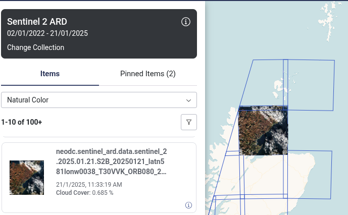
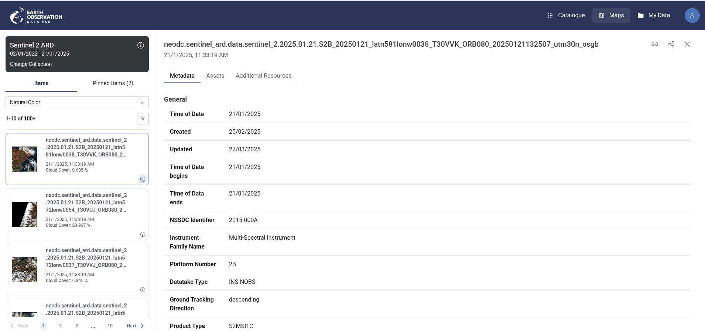
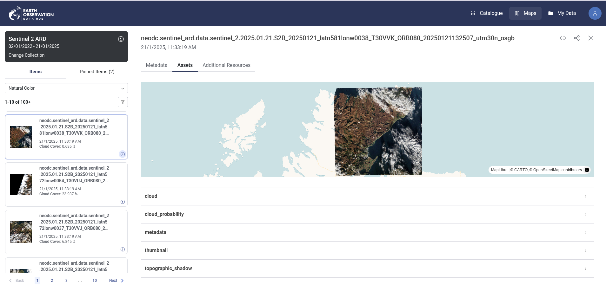
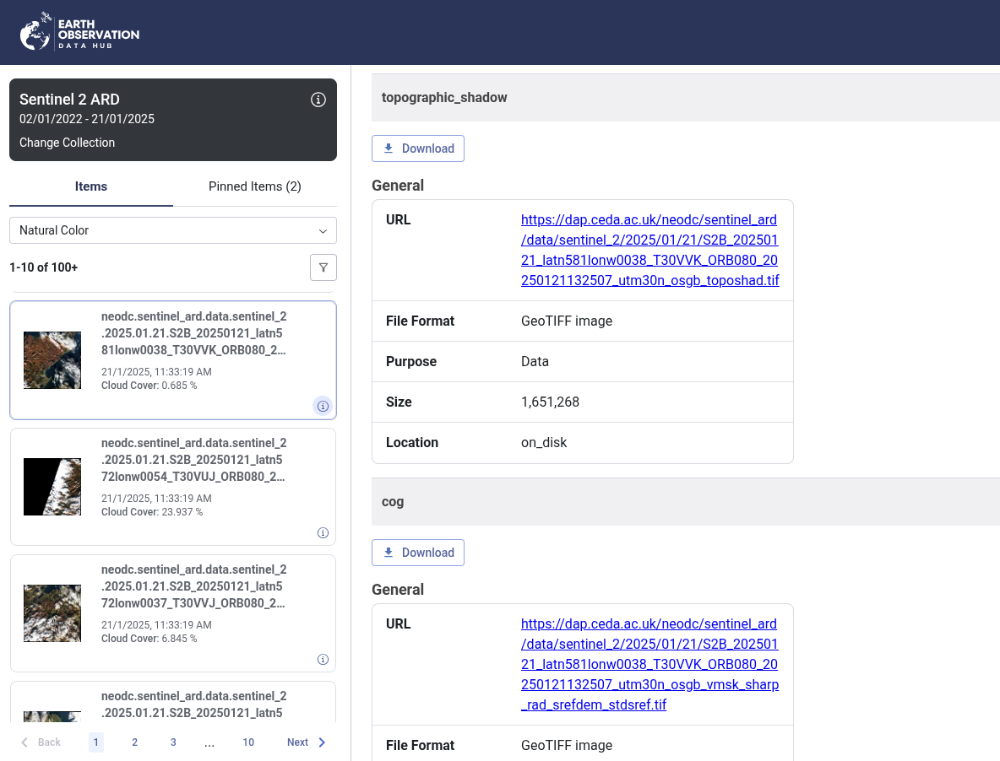

# Downloading data

Open datasets can be downloaded from the catalogue to be used locally or imported into third-party software. Commercial data can be downloaded, once an order has been placed, from the My Data area. More information on this can be found here. Following the steps below for commercial data collections will allow you to download a thumbnail of the image, at a lower resolution and quality compared to the image product, to carry out a visual assessment before purchasing the data.

## Find your scene

To download open data from the Resource Catalogue, first select the scene you want to download, by browsing and filtering the left hand panel to search.

Click on the (i) button on the bottom right of the card. This opens up the metadata panel.

## Go to the Assets panel

Select Assets. This tab details the files that are associated with that scene. For example, Sentinel 2 scenes contain different files such as cloud, cloud probability, or topographic shadow.

## Download the image file

Expand the asset you are interested in by clicking on it, and select Download. You can download any of the assets for a given scene. Depending on the collection you selected, different file types may be available.

## Understanding file types

Most open data collections contain at least one common image file type, such as GeoTIFF or NetCDF files. Some collections come as Cloud Optimised GeoTIFF (cog) files when downloaded, which are another image file type containing the data for the scene itself.

## 💳 Download requester-pays data

Requester-pays datasets are a type of data collection available to search, preview and download within the EODH Resource Catalogue. For requester-pays datasets, a small compute charge applies when the data is fetched from the host catalogue where it is stored for local download. On EODH, downloading this data uses workspace credits and is charged per GB.

!!! note

    Open-access data collections can follow the requester-pays model for download.

You must sign in before you are able to download requester-pays data. During the download process, select a workspace so that the download charges can be applied to the correct workspace. You should see the following warning message on the Download tab:

- ⬇️ Downloads are charged in credits per GB to the selected workspace.
- 🖼️ Downloading thumbnails and pinning map previews is free.
- 🕒 Charges can take up to **7 hours** to appear on the **[Usage](https://eodatahub.org.uk/static-apps/sg-rc-ui/prod/index.html#/accounting/usage)** and **[Credits](https://eodatahub.org.uk/static-apps/sg-rc-ui/prod/index.html#/accounting/credits)** pages, where you can monitor your credits usage.

You can use the licence filters on the catalogue Browse page to identify collections that use the requester-pays model for downloading.

[Browse requester pays collections :material-arrow-right:](https://eodatahub.org.uk/static-apps/sg-rc-ui/prod/index.html#/?license=lic%3Arequester-pays){ .md-button .md-button--primary target="_blank" }
